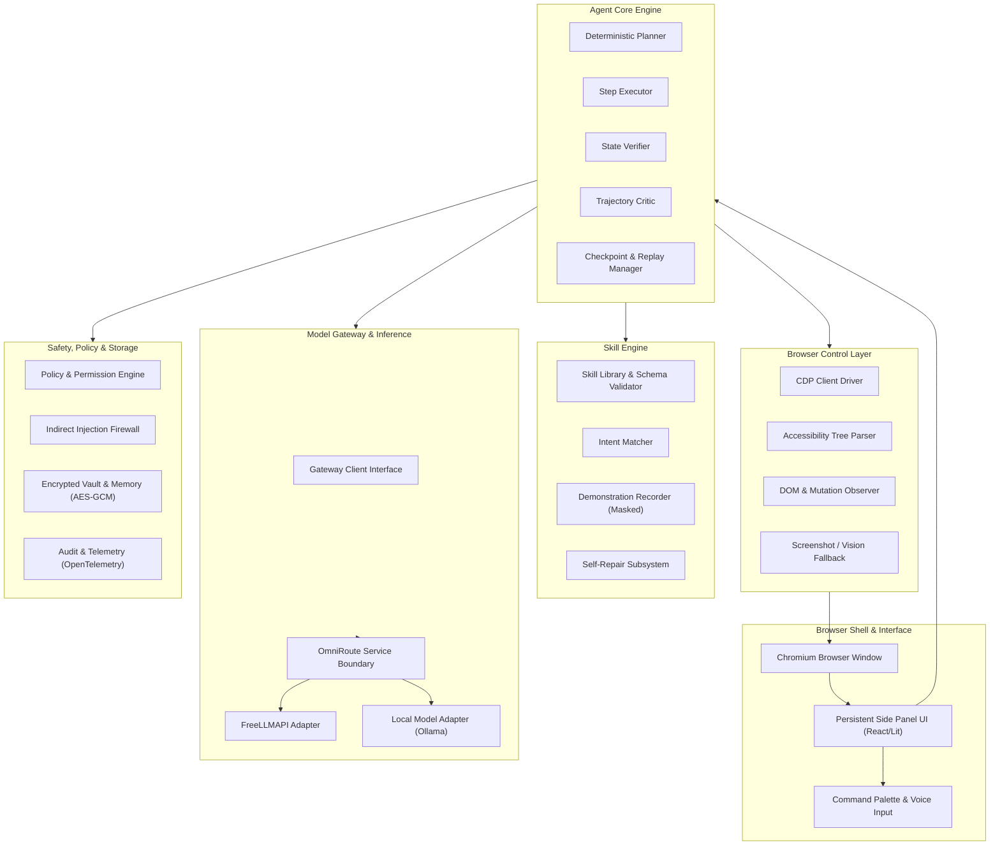
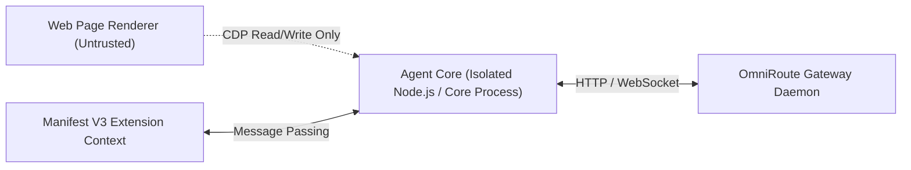

# System Architecture: Agentic Browser

## Architectural Overview

The Agentic Browser is engineered as a modular, local-first system designed for reliable long-term web automation. It decouples the browser user experience from the agent execution core, ensuring process isolation, least-privilege security boundaries, and strict data sanitization.



## System Layers and Components

### 1. Browser Shell and Side Panel UI
- **Host**: Chromium-based shell (Google Chrome / Chromium) running a Manifest V3 extension.
- **Side Panel**: Persistent webview interface providing user task inputs, live progress visualization, step-by-step diff inspection, human-in-the-loop approval dialogs, and manual control overrides.
- **Command Palette & Voice Input (ADR-0013)**: Fast modal interface supporting keyboard shortcuts and Web Speech API speech-to-text recognition across both the Side Panel command bar and Braver Search SERP (`search.html`), with bilingual English (`en-US`) and Bangla (`bn-BD`) transcription and non-blocking toast notifications.

### 2. Browser Control Layer
- **Interface**: Chrome DevTools Protocol (CDP) WebSocket connection (`chrome.debugger` or local CDP port `9222`).
- **Live Chrome Observation (ADR-0009)**: Recreates `rea-main`'s `CdpConnection` WebSocket protocol to establish real-time JSON-RPC duplex communication with Google Chrome and Brave. Dispatches live commands (`Page.navigate`, `Runtime.evaluate`, `DOM.getDocument`, `Page.captureScreenshot`), extracts live DOM node counts and interactive elements, and streams live browser targets via SSE (`/api/stream`).
- **Omnibox Destination & Search Engine**: Normalizes user input into direct site navigation (e.g. `facebook` -> `https://www.facebook.com`, `youtube` -> `https://www.youtube.com`), domain TLD resolution, and routes arbitrary search queries to Brave Search and Google Search with real-time autocomplete suggestions.
- **Observation Priority**:
  1. *Accessibility Tree First*: Queries `Accessibility.getFullAXTree` to identify interactive elements by accessibility role, name, description, and state (`disabled`, `expanded`, `checked`).
  2. *DOM Querying*: Uses `DOM.getDocument` and `DOM.querySelector` for standard CSS/XPath resolution.
  3. *Vision Fallback*: Takes localized viewport screenshots via `Page.captureScreenshot` for visual canvas elements or non-standard custom controls.
- **Targeting**: Multi-strategy selector tuples combining AX Role/Name, CSS path, test IDs, and bounding box geometry.

### 3. Agent Core
- **Execution Loop**:
  ```mermaid
  sequenceDiagram
      autonumber
      participant User
      participant Agent as Agent Core
      participant Policy as Policy Engine
      participant CDP as Control Layer
      participant Model as Model Gateway
      participant Verifier

      User->>Agent: Submit Goal
      Agent->>CDP: Fetch Observation (AX Tree + DOM)
      CDP-->>Agent: Structured Page State
      Agent->>Policy: Validate Constraints & Domain
      Policy-->>Agent: Permitted
      Agent->>Model: Request Next Step (Schema Validated)
      Model-->>Agent: Action Step
      alt Step Requires Confirmation
          Agent->>User: Request Approval (Hand-off/Prompt)
          User-->>Agent: Approved
      end
      Agent->>CDP: Dispatch Primitive Action
      CDP-->>Agent: Action Dispatched
      Agent->>Verifier: Verify Post-Condition
      Verifier-->>Agent: Condition Verified / Failed
  ```
- **State Machine**: Maintains immutable state transitions with serializable checkpoints stored after every step.
- **Controls**: Hard pause, step-by-step debug stepping, emergency kill switch, and automated crash recovery.

### 4. Skill Engine
- **Specification**: Skills are declarative JSON files conforming to `skill.schema.json`.
- **Demonstration Recorder**: Observes human browsing sessions via CDP event logging; automatically redacts passwords, masked inputs, and token cookies; extracts parameterized flows.
- **Self-Repair Loop**: When a skill step fails on a target site, the repairer analyzes semantic drift, evaluates candidate selectors against cached AX models, runs local tests, and issues an updated semver skill.
- **Cryptographic Signing and Verification (ADR-0013)**: Skills support native Ed25519 digital signatures (`ed25519:<sigHex>:<pubHex>`) calculated over canonically ordered JSON payloads (omitting the `signature` field). The `SkillKeyring` manages trusted signers. When importing third-party skills, the `SkillCryptoEngine` verifies cryptographic integrity and requires mandatory human-in-the-loop interactive review for untrusted signers or high/critical risk actions before library registration or execution.

### 5. Model Gateway
- **Boundary**: All model interactions pass through an abstracted gateway client implementing an OpenAI-compatible interface.
- **OmniRoute Integration**: Handles dynamic multi-provider routing, retry backoffs, and rate-limit mitigation.
- **Structured Validation**: Every model response is strictly validated against TypeScript Zod / JSON schemas. Malformed outputs trigger automated correction prompts before execution.

### 6. Safety, Vault, and Security
- **Untrusted Page Boundary**: All content originating from web pages is treated strictly as untrusted user data. HTML attributes, text contents, and scripts are stripped of prompt injection vectors before contextual assembly.
- **Encrypted Vault**: Credentials and profile data are encrypted locally using AES-256-GCM. Decryption occurs only at the exact point of field dispatch.
- **Audit Logging**: Structured JSONL audit log captures all dispatched actions, safety decisions, and policy events.

## Process Isolation Architecture



The Agent Core executes outside of the web page renderer context to prevent malicious script injection or page tampering from compromising the automation engine or stored vault credentials.

### 7. In-Browser Standalone GitHub Pages Backend & Universal Web Unblocker (ADR-0012)
- **Service Worker In-Browser Backend (`public/sw.js`)**: Intercepts `/api/*` network requests directly inside the browser on GitHub Pages. Powers AI Copilot (`/api/ai/chat`), live search (`/api/search`), autonomous task execution (`/api/run-task`), and telemetry without requiring a local Node.js process. Implements v2 cache eviction in the `activate` event to invalidate stale cached assets on redeployment.
- **Transparent Client-Side Fetch Router (`public/app.js`)**: Provides an immediate in-memory fallback router wrapping `window.fetch`, guaranteeing that API requests succeed even if Service Workers are restricted (e.g., in private browsing or file origins).
- **Universal Web Unblocker (`public/portal.html`)**: Prevents "refused to connect" errors on external search results and framing-restricted sites. YouTube videos stream via ad-free responsive players (`https://www.youtube-nocookie.com/embed/...`), destinations like Facebook render full interactive portals with live feeds and post creators, and GitHub provides a dedicated Developer Portal with live external launch, trending repository searches, and autonomous agent recon.
- **Graceful CDP Offline & Recovery UI**: Replaces broken image placeholders on offline CDP connections with a glassmorphic `#cdp-fallback-card` offering one-click return to Web View (`#btn-cdp-return-web`), terminal launch guidance, and automatic Web View restoration upon any omnibox navigation.

### 8. Vercel CLI Deployment & Universal Live Web Proxy Pipeline (ADR-0014)
- **Vercel Serverless Function Proxy (`api/proxy.js`)**: Edge serverless function deployed at `/api/proxy`. Fetches any destination URL on demand with server-side TLS and desktop Chrome emulation, strips `X-Frame-Options` and CSP `frame-ancestors`, injects `<base href="...">` and anti-frame-busting shims, and intercepts relative links and form submissions so users can browse any website live without iframe connection refusal.
- **Artifact Optimization (`.vercelignore` & `vercel.json`)**: Filters out >6 GB of local vendor source trees (`chromium-main`, `OmniRoute`, `freellmapi`, `rea`) and media assets (`1.mp4`), optimizing deployable payload to ~3.5 MB. Configures `outputDirectory: "public"`, clean URLs, and `Service-Worker-Allowed: /` headers for `public/sw.js`.
- **Dynamic Host Resolution (`public/app.js`)**: Evaluates `isStaticOnlyHosting` to distinguish static-only GitHub Pages from Vercel deployments and localhost, routing external web navigations directly through `/api/proxy` to deliver seamless live browsing across arbitrary URLs.

### 9. Real-Time Browser Live Proxy Resilience & Navigation Pipeline (ADR-0015)
- **Search Engine Redirect Unwrapping**: Both `api/proxy.js` and `omnibox-resolver.js` automatically detect and unwrap Google `/url` and `/goto` redirect links, extracting real target URLs (`destParam`) rather than fetching Google redirect warning pages with `igu=1`.
- **TLS Resilience & Protocol Failover**: Configures `NODE_TLS_REJECT_UNAUTHORIZED = '0'` and dual protocol fallback (HTTPS to HTTP and vice versa) with modern browser telemetry headers (`User-Agent`, `Sec-Ch-Ua`, `Sec-Fetch-Dest: document`), eliminating `fetch failed` connection and handshake aborts.
- **Parent Bridge & Universal Interception**: Injects an enhanced `antiFrameBustShim` into proxied HTML that intercepts all anchor clicks (including `target="_blank"`), unwraps nested `/api/proxy?url=` loops, intercepts `window.open` and forms, and posts `BRAVE_NAVIGATE` to the parent window to keep the omnibox, active tab title, and navigation history in sync in real time.
- **Real-Time Live Web View**: Eliminates artificial redirects to `portal.html` for Facebook, GitHub, and external sites on Vercel and localhost, allowing true live web browsing.

### 10. Real-Time Browser Universal Navigation & Subresource Optimization (ADR-0016)
- **Omnibox Query Redirection**: Automatically detects search queries without TLDs in `api/proxy.js` and issues HTTP 302 redirects to `/search.html?q=...` instead of failing with `TypeError: fetch failed`.
- **Subresource Direct CDN Loading**: Discontinues recursive proxying of `<script src>` and `<link href>` tags. Uses `<base href>` and stripped `crossorigin`/`integrity` attributes so subresources load directly from origin CDNs with zero proxy bottleneck or concurrency exhaustion.
- **Percent-Decoding Unwrapper**: Recursively decodes percent-encoded destination URLs across all URL parsing components.

### 11. Elimination of Mock Templates & Real-Time Live SPA Pipeline (ADR-0017)
- **Zero Mock Templates**: Completely eliminates hardcoded mock catalogs and simulated social feeds. Preserves real live website rendering for all web destinations (YouTube, Google, Facebook, GitHub, Wikipedia, etc.).
- **Authentic Video Streaming**: Routes specific YouTube watch URLs (`/watch?v=...`) directly to the official ad-free nocookie embed player (`https://www.youtube-nocookie.com/embed/${videoId}`), while allowing general YouTube pages (homepage, search results, channels) to stream live web content via proxy and CDP.
- **Transparent SPA Fetch & XHR Routing**: Injects client-side API interception in `bridgeScript` and `antiFrameBustShim` that resolves relative and cross-origin endpoints against `window.__BRAVE_PROXY_URL__` and routes them through `/api/proxy?url=...`, enabling full SPA interactivity without CORS or 404 failures.
- **POST Proxying**: Enables `POST` method support and request body forwarding in `/api/proxy` to serve modern SPA APIs.
### 12. Malformed Query Repair & Anti-Adblock Neutralization Pipeline (ADR-0018)
- **Sanitize & Repair URLs**: `sanitizeAndRepairUrl` detects and fixes query strings appended with `&` without an initial `?` (e.g. `https://www.youtube.com&themeRefresh=1` -> `https://www.youtube.com/?themeRefresh=1`), preventing DNS resolution failures (`ENOTFOUND`) and proxy gateway notices.
- **Secondary Parameter Association**: When unencoded query parameters are attached to the proxy endpoint, they are cleanly merged into the target URL rather than corrupting the URL scheme or host.
- **Anti-Adblock Script Stripping**: Automatically strips obfuscated third-party anti-adblock detection scripts (Admiral, BlockThrough, Uponit via `castlereach.com`, `succeedscene.com`) before HTML delivery.
- **CSS Suppression Rules**: Injects stylesheet rules in `#brave-shields-adblock` hiding anti-adblock overlay containers (`.DCDOr`, `[class*="a__s1p0xe8r"]`) and guaranteeing `html, body { overflow: auto !important; }`.
- **Publisher GPT / CMP Stubs**: Injects dummy stubs for Google Publisher Tag (`window.googletag`), AdSense (`window.adsbygoogle`), and CMP (`window.__tcfapi`) to disarm runtime blocker detection and prevent lockout nag screens on publishers like TechCrunch.

### 13. Self-Hosted Real-Time Chrome CDP Auto-Supervision & Viewport Synchronization (ADR-0019)
- **Autonomous Local Supervisor**: `scripts/serve-localhost.mjs` actively supervises headless Google Chrome / Chromium on port `9222`. Cleans up stale profile locks (`SingletonLock`, `SingletonSocket`, `SingletonCookie`) in `/tmp/chrome-real-user-profile` before launching to prevent deadlocks from unclean shutdowns.
- **Heartbeat & Self-Healing**: Checks CDP health every 10 seconds and automatically revives the Chrome daemon if terminated.
- **Status Endpoint Parity**: Exposes `/api/chrome/status` and `/api/chrome/health` returning `{ connected, browser, targetsCount, port: 9222, mode: 'self-hosted' }`, allowing `public/app.js` to immediately activate the live stream canvas without rendering connection warning cards.
- **Real-Time Screencast & Input Relay**: Supports target auto-provisioning and captures JPEG screenshot frames every 150ms for low-latency visual observation, while forwarding user clicks, keystrokes, and scrolling events directly into the browser basement.

### 14. Live Chrome Primary Viewport & CDP Brave Shields Ad-Blocking Pipeline (ADR-0020)
- **Primary Viewport Mode**: `public/app.js` initializes directly with `viewportMode = 'cdp'` on local environments, bypassing the iframe proxy and rendering the live hardware-accelerated Chrome stream from boot. Omnibox navigation remains locked in Live Chrome without automatic mode kickouts.
- **CDP Socket-Level URL Blocking (`Network.setBlockedURLs`)**: Blocks 32+ prominent ad networks, tracker domains, and telemetry endpoints (DoubleClick, GoogleSyndication, GoogleAdServices, Criteo, Taboola, Outbrain, Amazon AdSystem, Admiral, YouTube ad beacons) directly at the browser network socket layer before byte transfer.
- **CDP DOM-Level Ad Suppression (`Page.addScriptToEvaluateOnNewDocument`)**: Automatically injects CSS rules hiding ad slots (`ins.adsbygoogle`, `ytd-ad-slot-renderer`, `.ytp-ad-module`, `#masthead-ad`, Taboola/Outbrain containers) and anti-adblock blocker walls (`.DCDOr`).
- **YouTube Video Ad Auto-Skipper & Fast-Forwarder**: Runs a continuous client-side loop inside Chrome that auto-clicks skip buttons (`.ytp-ad-skip-button`, `.ytp-skip-ad-button`), mutes in-stream ads, and advances the video timeline directly to the ad end (`video.currentTime = video.duration || 99999`).
- **Anti-Adblock Defusers**: Injects dummy stubs for `window.googletag`, `window.adsbygoogle`, and `window.__tcfapi` to defuse anti-adblock detection routines before publisher scripts execute.
- **Double-Buffered Self-Pacing Screencast**: Uses an asynchronous `onload`-driven rendering pipeline with a 60ms pacing cadence and a 20-frame resilience threshold, preventing visual flicker or premature fallback cards during heavy page navigation.
- **Capped Resource Footprint**: Restricts disk and media cache sizes to 20MB (`--disk-cache-size=20971520`, `--media-cache-size=20971520`) in `scripts/launch-chrome-cdp.sh` to prevent host disk exhaustion.

### 15. Local Internal Page Isolation & Omnibox Search Scheme Protection (ADR-0021)
- **Local Route Shielding**: `sanitizeAndRepairUrl` guards all relative internal `.html` files (`search.html`, `newtab.html`, `portal.html`, `catalog.html`, `form.html`, `auth-hand-off.html`, `index.html`) from being treated as external top-level domains, preventing protocol corruption into `https://search.html`.
- **Corrupted URL Auto-Healing**: Strips any accidental `https://` or `http://` prefixes from internal page names and restores clean relative paths.
- **Omnibox Destination Classification**: Explicitly resolves internal HTML pages (with or without query strings) as `{ type: 'internal', url: cleanInternal }` in `resolveOmniboxDestination`.
- **Proxy Redirection Layer**: In both serverless (`api/proxy.js`) and local dev (`scripts/serve-localhost.mjs`), incoming proxy requests targeting internal HTML files are immediately answered with HTTP 302 redirects to their respective static relative paths, eliminating DNS resolution errors (`ENOTFOUND search.html`) in deployed cloud environments.
