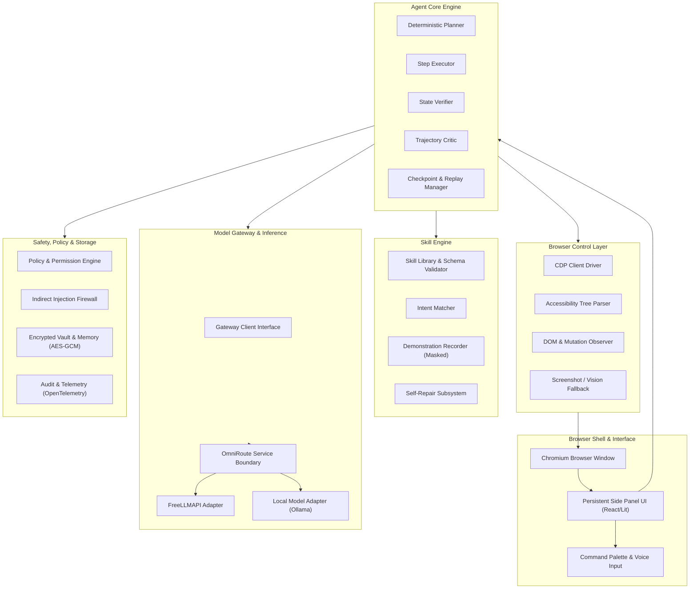
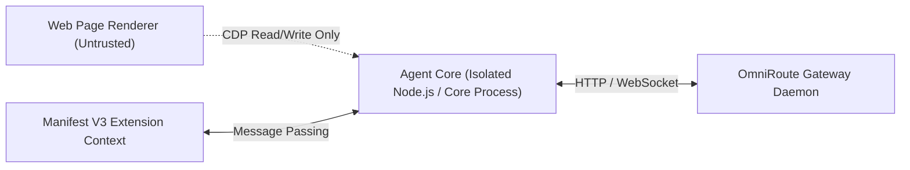

# System Architecture: Agentic Browser

## Architectural Overview

The Agentic Browser is engineered as a modular, local-first system designed for reliable long-term web automation. It decouples the browser user experience from the agent execution core, ensuring process isolation, least-privilege security boundaries, and strict data sanitization.



## System Layers and Components

### 1. Browser Shell and Side Panel UI
- **Host**: Chromium-based shell (Google Chrome / Chromium) running a Manifest V3 extension.
- **Side Panel**: Persistent webview interface providing user task inputs, live progress visualization, step-by-step diff inspection, human-in-the-loop approval dialogs, and manual control overrides.
- **Command Palette & Voice Input (ADR-0013)**: Fast modal interface supporting keyboard shortcuts and Web Speech API speech-to-text recognition across both the Side Panel command bar and Braver Search SERP (`search.html`), with bilingual English (`en-US`) and Bangla (`bn-BD`) transcription and non-blocking toast notifications.

### 2. Browser Control Layer
- **Interface**: Chrome DevTools Protocol (CDP) WebSocket connection (`chrome.debugger` or local CDP port `9222`).
- **Live Chrome Observation (ADR-0009)**: Recreates `rea-main`'s `CdpConnection` WebSocket protocol to establish real-time JSON-RPC duplex communication with Google Chrome and Brave. Dispatches live commands (`Page.navigate`, `Runtime.evaluate`, `DOM.getDocument`, `Page.captureScreenshot`), extracts live DOM node counts and interactive elements, and streams live browser targets via SSE (`/api/stream`).
- **Omnibox Destination & Search Engine**: Normalizes user input into direct site navigation (e.g. `facebook` -> `https://www.facebook.com`, `youtube` -> `https://www.youtube.com`), domain TLD resolution, and routes arbitrary search queries to Brave Search and Google Search with real-time autocomplete suggestions.
- **Observation Priority**:
  1. *Accessibility Tree First*: Queries `Accessibility.getFullAXTree` to identify interactive elements by accessibility role, name, description, and state (`disabled`, `expanded`, `checked`).
  2. *DOM Querying*: Uses `DOM.getDocument` and `DOM.querySelector` for standard CSS/XPath resolution.
  3. *Vision Fallback*: Takes localized viewport screenshots via `Page.captureScreenshot` for visual canvas elements or non-standard custom controls.
- **Targeting**: Multi-strategy selector tuples combining AX Role/Name, CSS path, test IDs, and bounding box geometry.

### 3. Agent Core
- **Execution Loop**:
  ```mermaid
  sequenceDiagram
      autonumber
      participant User
      participant Agent as Agent Core
      participant Policy as Policy Engine
      participant CDP as Control Layer
      participant Model as Model Gateway
      participant Verifier

      User->>Agent: Submit Goal
      Agent->>CDP: Fetch Observation (AX Tree + DOM)
      CDP-->>Agent: Structured Page State
      Agent->>Policy: Validate Constraints & Domain
      Policy-->>Agent: Permitted
      Agent->>Model: Request Next Step (Schema Validated)
      Model-->>Agent: Action Step
      alt Step Requires Confirmation
          Agent->>User: Request Approval (Hand-off/Prompt)
          User-->>Agent: Approved
      end
      Agent->>CDP: Dispatch Primitive Action
      CDP-->>Agent: Action Dispatched
      Agent->>Verifier: Verify Post-Condition
      Verifier-->>Agent: Condition Verified / Failed
  ```
- **State Machine**: Maintains immutable state transitions with serializable checkpoints stored after every step.
- **Controls**: Hard pause, step-by-step debug stepping, emergency kill switch, and automated crash recovery.

### 4. Skill Engine
- **Specification**: Skills are declarative JSON files conforming to `skill.schema.json`.
- **Demonstration Recorder**: Observes human browsing sessions via CDP event logging; automatically redacts passwords, masked inputs, and token cookies; extracts parameterized flows.
- **Self-Repair Loop**: When a skill step fails on a target site, the repairer analyzes semantic drift, evaluates candidate selectors against cached AX models, runs local tests, and issues an updated semver skill.
- **Cryptographic Signing and Verification (ADR-0013)**: Skills support native Ed25519 digital signatures (`ed25519:<sigHex>:<pubHex>`) calculated over canonically ordered JSON payloads (omitting the `signature` field). The `SkillKeyring` manages trusted signers. When importing third-party skills, the `SkillCryptoEngine` verifies cryptographic integrity and requires mandatory human-in-the-loop interactive review for untrusted signers or high/critical risk actions before library registration or execution.

### 5. Model Gateway
- **Boundary**: All model interactions pass through an abstracted gateway client implementing an OpenAI-compatible interface.
- **OmniRoute Integration**: Handles dynamic multi-provider routing, retry backoffs, and rate-limit mitigation.
- **Structured Validation**: Every model response is strictly validated against TypeScript Zod / JSON schemas. Malformed outputs trigger automated correction prompts before execution.

### 6. Safety, Vault, and Security
- **Untrusted Page Boundary**: All content originating from web pages is treated strictly as untrusted user data. HTML attributes, text contents, and scripts are stripped of prompt injection vectors before contextual assembly.
- **Encrypted Vault**: Credentials and profile data are encrypted locally using AES-256-GCM. Decryption occurs only at the exact point of field dispatch.
- **Audit Logging**: Structured JSONL audit log captures all dispatched actions, safety decisions, and policy events.

## Process Isolation Architecture



The Agent Core executes outside of the web page renderer context to prevent malicious script injection or page tampering from compromising the automation engine or stored vault credentials.

### 7. In-Browser Standalone GitHub Pages Backend & Universal Web Unblocker (ADR-0012)
- **Service Worker In-Browser Backend (`public/sw.js`)**: Intercepts `/api/*` network requests directly inside the browser on GitHub Pages. Powers AI Copilot (`/api/ai/chat`), live search (`/api/search`), autonomous task execution (`/api/run-task`), and telemetry without requiring a local Node.js process.
- **Transparent Client-Side Fetch Router (`public/app.js`)**: Provides an immediate in-memory fallback router wrapping `window.fetch`, guaranteeing that API requests succeed even if Service Workers are restricted (e.g., in private browsing or file origins).
- **Universal Web Unblocker (`public/portal.html`)**: Prevents "refused to connect" errors on external search results and framing-restricted sites. YouTube videos stream via ad-free responsive players (`https://www.youtube-nocookie.com/embed/...`), and destinations like Facebook render full interactive portals with live feeds, post creators, and independent window launch actions.

