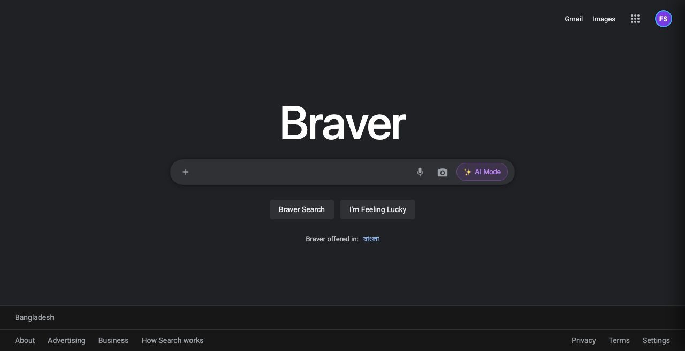
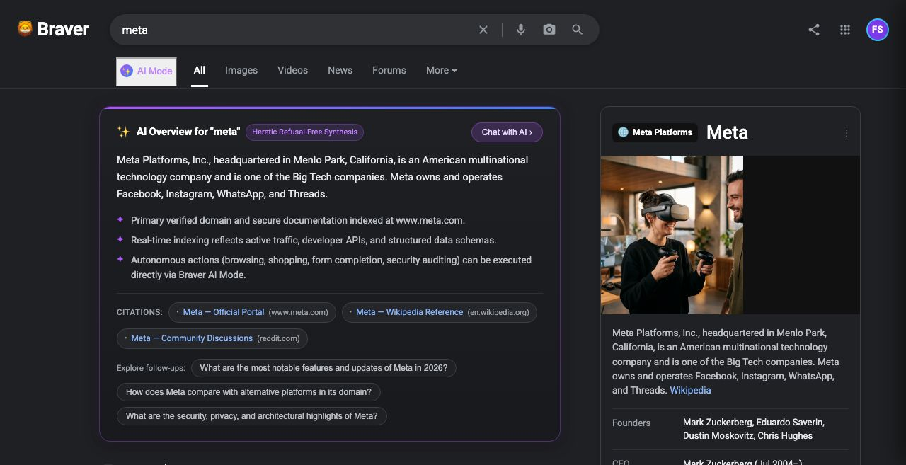

<div align="center">

# 🦁 OpenBrowser

### The Autonomous AI Agentic Browser for Hackers & Power Users

*Engineered by **[FS Ferdows](https://github.com/fsferdows)***

<p align="center">
  <a href="https://github.com/fsferdows/OpenBrowser/stargazers"></a>
  <a href="https://github.com/fsferdows/OpenBrowser/network/members"></a>
  <a href="https://github.com/fsferdows/OpenBrowser/blob/main/LICENSE"></a>
  <a href="https://github.com/fsferdows/OpenBrowser"></a>
  <a href="https://github.com/fsferdows/OpenBrowser"></a>
  <a href="https://github.com/fsferdows/OpenBrowser"></a>
</p>

<p align="center">
  <b>Stop switching between ChatGPT, Chrome tabs, and terminal scripts.</b><br>
  OpenBrowser brings the entire autonomous browser workstation directly onto <code>http://localhost:3000</code>.
</p>

---

### 🎥 Watch OpenBrowser in Action

[](./1.mp4)

> 📹 **High-Definition Demo**: [`1.mp4`](./1.mp4) (Included in repo — click to watch autonomous task execution, live SERP, and real-time Chromium CDP streaming).

---

</div>

## 💡 Why OpenBrowser?

Web browsers were designed in 2008 for human clicks. AI web agents today are trapped inside clumsy Python terminal wrappers, fragile Playwright scripts, and expensive commercial LLM paywalls.

**OpenBrowser completely redefines the browser experience:**

1. **⚡ 100% In-Browser Workstation (`localhost:3000`)**: Full Chromium engine running under the hood with real-time CDP streaming, mouse click forwarding, keyboard typing, and scroll wheel synchronization.
2. **🔓 Unaligned, Refusal-Free AI Mode**: Powered by the **Heretic Engine** + **OmniRoute** + **FreeLLMAPI**. No preachy refusal guardrails for security analysis, penetration testing, deep research, or autonomous web navigation.
3. **🛠️ Built-in HackSuite**: Native HTTP Repeater (CORS-bypassed), Attack Surface Analyzer, JWT/Hex/Base64 Decoder, and Penetration Testing Payloads right inside your bookmarks bar.
4. **🧠 Self-Healing Skill Engine**: Perform a workflow once. OpenBrowser records it, compiles it into a 16-field versioned skill, and **automatically repairs broken CSS/accessibility selectors** when websites change their layout.
5. **🆓 Zero-Cost & Local Freedom**: Native multi-provider failover across FreeLLMAPI, local Ollama, and commercial endpoints via OmniRoute.

---

## 📸 Screenshots

| 🦁 **Refusal-Free New Tab & Omnibox** | 🔍 **Live Search & Knowledge Graph** |
| :---: | :---: |
|  |  |
| *Minimal Google Dark UI with Refusal-Free AI Mode* | *Multi-category SERP (AI Mode, Web, Images, Videos, News)* |

---

## 🥊 Feature Comparison

| Feature | Regular Browsers (Chrome / Brave) | Script Agents (Browser-Use / AutoGPT) | 🦁 **OpenBrowser** |
| :--- | :---: | :---: | :---: |
| **User Interface** | Standard Manual UI | None (Headless CLI only) | **Full Interactive Localhost Webstation** |
| **AI Task Execution** | ❌ None | ⚠️ Requires API Keys & Terminal | **⚡ 1-Click Autonomous Agent** |
| **Model Routing** | ❌ Vendor Locked | ⚠️ Single Provider | **🔄 OmniRoute + FreeLLMAPI Zero-Cost** |
| **AI Alignment** | Standard Restrictions | Dependent on API | **🔓 Heretic Refusal-Free SecOps Engine** |
| **Self-Repairing Selectors**| ❌ None | ❌ Scripts break on DOM change | **🛡️ Heuristic Accessibility Tree Repair** |
| **Security Workstation** | ❌ DevTools only | ❌ None | **⚡ HackSuite HTTP Repeater & Payloads** |
| **SPAs (YouTube, Facebook)**| Native | ⚠️ Frequent Bot-Blocks | **🟢 Real-Time Headless CDP Streaming** |
| **In-Browser Authentication**| Native | ❌ Fails on 2FA/CAPTCHA | **🔑 Native Viewport Input Forwarding** |

---

## 🚀 Quick Start (60 Seconds)

### 1. Prerequisites
- **Node.js** >= 20.0.0
- **npm** >= 9.0.0
- **Google Chrome** or **Chromium** installed

### 2. One-Line Clone & Install

```bash
git clone https://github.com/fsferdows/OpenBrowser.git
cd OpenBrowser
npm install
```

### 3. Run Test Suite (196 Passing Tests)

```bash
npm test
```

### 4. Launch OpenBrowser

```bash
# Terminal 1: Launch the headless Chromium CDP engine
npm run browser:chrome

# Terminal 2: Start OpenBrowser Studio
npm start
```

👉 Open **[`http://localhost:3000`](http://localhost:3000)** in your browser!

---

## 🕹️ Guided Tour of Capabilities

### 1. Refusal-Free AI Mode (Heretic Engine)
Type any goal or query into the search bar or Omnibox:
```text
agent: extract all API endpoints from example.com and analyze security headers
```
OpenBrowser's agent perceives the DOM, plans the trajectory, executes actions, and returns an unrefused, structured audit.

### 2. HackSuite Pentesting Suite
Click the **`⚡ HackSuite`** button in the top navigation bar to open:
- **HTTP Repeater**: Send raw `GET`, `POST`, `PUT`, `DELETE` requests directly from your browser with complete CORS bypass.
- **Attack Surface Scanner**: Instantly discover forms, password inputs, missing CSP headers, and third-party tracking scripts.
- **Crypto & Encoding Tool**: Decode Base64, URL-encoded strings, Hex, and parse JWT token payloads on the fly.
- **Payload Arsenal**: 1-click injection payloads for XSS, SQLi, SSRF, Command Injection, and Directory Traversal.

### 3. Real-Time Chromium CDP Live Stream
Switch between **`🌐 Web View`** (lightweight proxy with Brave Shields tracker blocking) and **`⚡ Live Chrome`** (high-fidelity Chromium DevTools Protocol screen stream).
- Click into any input field on the canvas to focus.
- Type credentials, queries, and shortcuts directly from your physical keyboard.
- Scroll smoothly using your mouse wheel.

### 4. Embedded In-Browser Sign In
Click **`🔑 Sign In`** to authenticate your Google, YouTube, Facebook, GitHub, or X accounts directly inside the OpenBrowser viewport. All session cookies and credentials persist locally in your isolated profile.

---

## 🏗️ Architecture


---

## 🛡️ Security, Privacy & Compliance

- **OWASP Top 10 for LLM Applications**: Active Prompt Injection Firewall, XML boundary isolation, and canary token leak defense.
- **Zero Secret Exfiltration**: AES-256-GCM encrypted credential vault with process-wide secret scrubbing across all telemetry.
- **Strict Human-in-the-Loop Policy**: Financial transactions, credential updates, and destructive operations mandate user approval.
- **WCAG 2.2 AA & Multi-Language**: Shipped with native English (`en`) and Bangla (`bn`) localization with high-contrast accessibility controls.

---

## 🗺️ Roadmap

- [x] Chromium CDP WebSocket Duplex Integration (Port 9222)
- [x] Heretic Refusal-Free Intelligence with OmniRoute & FreeLLMAPI
- [x] HackSuite Security Pentesting Workstation (Repeater, Decoder, Analyzer)
- [x] In-Browser Headless Authentication with Keyboard/Scroll Forwarding
- [x] Dynamic Live Search Engine (DuckDuckGo + Wikipedia REST API)
- [ ] Multi-Agent Parallel Swarm Execution
- [ ] WebAssembly Network Interceptor & Packet Analyzer
- [ ] Export learned skills directly to autonomous GitHub Actions workflows

---

## 👨‍💻 Developer & Visionary

**OpenBrowser** is created and maintained by:

<p align="left">
  <b>FS Ferdows</b><br>
  <i>Remote Senior Design Engineer & AI Architect</i><br>
  GitHub: <a href="https://github.com/fsferdows">@fsferdows</a><br>
  Portfolio: <a href="https://www.fsferdows.com">fsferdows.com</a><br>
  Contact: <a href="mailto:fsferdows@icloud.com">fsferdows@icloud.com</a>
</p>

---

## ⭐ Star History

If you love the concept of an autonomous, refusal-free browser workstation, give us a star on GitHub!

[](https://star-history.com/#fsferdows/OpenBrowser&Date)

---

## 📄 License

Licensed under the **Apache License, Version 2.0**. See [THIRD_PARTY_NOTICES.md](./THIRD_PARTY_NOTICES.md) for third-party disclosures.
