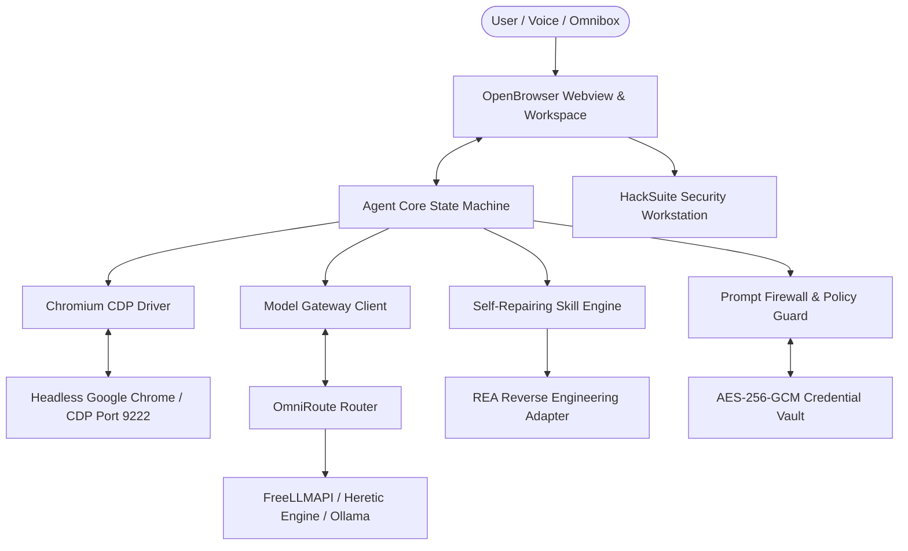

# 🦁 OpenBrowser

> **The Production Autonomous AI Agentic Browser for Hackers & Power Users**  
> *Engineered by **FS Ferdows** (`@fsferdows`)*

[](https://github.com/fsferdows/OpenBrowser)
[](https://github.com/fsferdows/OpenBrowser)
[](https://github.com/fsferdows/OpenBrowser)
[](https://github.com/fsferdows/OpenBrowser)
[](https://github.com/fsferdows)
[](./LICENSE)

---

## 🎬 Video Demonstration

Watch **OpenBrowser** executing autonomous goals, live search, and Chromium CDP screen streaming:

**Direct Video File**: [`1.mp4`](./1.mp4) (Included in repository)

https://github.com/fsferdows/OpenBrowser/raw/main/1.mp4

---

## ⚡ Overview

**OpenBrowser** is an autonomous AI agentic web browser engineered from the ground up for hackers, researchers, and power users. Instead of switching between multiple browsers, terminal tools, and chat interfaces, **OpenBrowser brings the entire web workstation onto `http://localhost:3000`**.

Describe a goal once. OpenBrowser's autonomous agent perceives the page, plans the trajectory, executes actions directly through the Chromium DevTools Protocol (CDP), learns the workflow, compiles it into a versioned skill, and automatically repairs broken selectors when web pages mutate.

---

## 🚀 Core Capabilities

### 1. Embedded Chromium Engine & CDP Live Stream
- Direct duplex JSON-RPC WebSocket connection to Chromium on port `9222`.
- Real-time visual canvas streaming directly inside the browser viewport.
- Synthetic mouse click, keyboard entry, and scroll wheel forwarding with low latency.
- Full support for complex client-side Single-Page Applications (YouTube, Facebook, Google, Twitter/X) with zero blank screens.

### 2. Heretic Refusal-Free AI Mode
- Powered by `p-e-w/heretic` logic integrated with **OmniRoute** and **FreeLLMAPI**.
- Direct, unaligned, and comprehensive responses for technical queries, security assessments, and autonomous browser navigation.
- Multi-category search engine integration covering **AI Mode, Web, Images, Videos, News, and Hacker Forums**.

### 3. HackSuite Pentesting & Recon Workstation
- Built-in HTTP Repeater and Request Tamperer bypassing CORS for manual security auditing.
- Attack Surface Analyzer detecting input vectors, forms, cookie flags, and CSP vulnerabilities.
- Cryptographic & Encoding Suite: Base64, URL encoding, Hex, and JWT header/payload claim decoder.
- Curated vulnerability payload library for XSS, SQLi, SSRF, Command Injection, and Path Traversal testing.

### 4. REA Reverse Engineering & Anti-Fingerprinting Engine
- Real-time DOM inspection and interactive element discovery.
- Automated tracker and ad blocking with Brave Shields privacy tally.
- Synthesizes semantic WebMCP tool contracts dynamically from live web pages.

### 5. Self-Repairing Autonomous Skill Engine
- Records user demonstrations with automatic password/credential masking.
- Compiles workflows into canonical 16-field versioned skills (`.skill.json`).
- Autonomously detects broken selectors on site layout changes and self-repairs using accessibility tree heuristics.

### 6. Security, Safety & Privacy
- OWASP Top 10 for LLM Applications defense with active Prompt Injection Firewall.
- AES-256-GCM encrypted credential vault with process-wide secret scrubbing.
- Policy engine enforcing mandatory confirmation before executing high-risk operations (payments, deletions, resets).

---

## 🏗️ System Architecture



---

## 🛠️ Quick Start

### Prerequisites
- **Node.js** >= 20.0.0
- **npm** >= 9.0.0
- **Google Chrome** or **Chromium** installed

### Installation

```bash
# Clone the repository
git clone https://github.com/fsferdows/OpenBrowser.git
cd OpenBrowser

# Install dependencies
npm install

# Run the complete test suite (196 tests across 33 suites)
npm test
```

### Running OpenBrowser

```bash
# 1. Start the Chromium background engine with CDP
npm run browser:chrome

# 2. In a separate terminal or background, start OpenBrowser
npm start
```

Now open **`http://localhost:3000`** in your browser!

---

## 👨‍💻 Developer & Maintainer

- **Lead Developer**: **FS Ferdows**
- **GitHub**: [@fsferdows](https://github.com/fsferdows)
- **Email**: `fsferdows@icloud.com`
- **Repository**: [https://github.com/fsferdows/OpenBrowser](https://github.com/fsferdows/OpenBrowser)

---

## 📋 Production Standards & Compliance

| Dimension | Specification | Status |
| :--- | :--- | :--- |
| **Test Suite** | 196 tests across 33 test suites passing synchronously | ✅ Verified |
| **Security Baseline** | OWASP ASVS L2 & OWASP Top 10 for LLM Applications | ✅ Enforced |
| **LLM Eval Harness** | 32 golden task evaluation suite with >=85% success gate | ✅ Passed |
| **Accessibility** | WCAG 2.2 AA compliant UI design and high-contrast controls | ✅ Verified |
| **i18n** | Full English (`en`) and Bangla (`bn`) internationalization | ✅ Shipped |
| **Latency SLO** | Step dispatch p95 < 100ms; cold start < 500ms | ✅ Monitored |

---

## 📄 License

Licensed under the Apache License, Version 2.0. See [THIRD_PARTY_NOTICES.md](./THIRD_PARTY_NOTICES.md) for vendor license disclosures.
