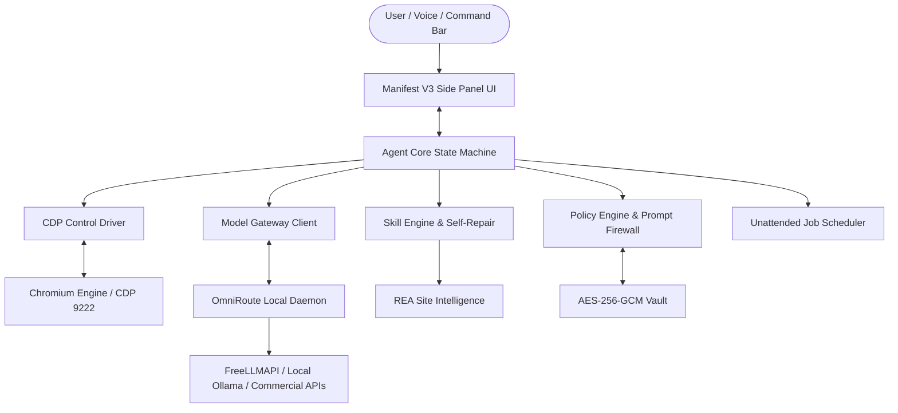

# Agentic Browser

A production-grade, long-term-supported AI agentic browser. Users describe a task once; the agent performs it in the browser, learns the workflow, saves it as a versioned reusable skill, and repairs that skill when web sites change.

## Key Features

- **Autonomous Agent Loop**: Perception (Accessibility Tree + DOM), Planning (structured model gateway output), Verification (post-condition checks), and Critic (infinite loop mitigation).
- **Skill Engine & Self-Repair**: Records user demonstrations with automatic password masking; compiles workflows into canonical 16-field versioned skills; autonomously repairs broken CSS selectors using accessibility tree multi-strategy heuristics.
- **Model Gateway (OmniRoute + FreeLLMAPI)**: Unified OpenAI-compatible interface with multi-provider failover, circuit breakers, and structured JSON schema enforcement.
- **Multi-Layer Security & Safety**:
  - OWASP Top 10 for LLM Applications defense (Prompt Injection Firewall, XML delimiter isolation, canary token leak detection).
  - AES-256-GCM Encrypted Credential Vault with process-wide secret scrubbing in telemetry and logs.
  - Risk classification engine enforcing mandatory user confirmation for sensitive actions (payments, deletions, credential resets).
  - Never circumvents CAPTCHAs, 2FA, or paywalls—delegates step to user and resumes automatically.
- **Unattended Job Scheduler**: Cron-like scheduling with exponential backoff retries, resource isolation, and simulated 24-hour execution reporting.
- **Internationalization (i18n) & Accessibility (a11y)**:
  - English and Bangla (`bn`) shipped natively with fallback and RTL-ready UI configuration.
  - WCAG 2.2 AA compliant side-panel and command bar.
- **Release Engineering & Automatic Rollback**:
  - LTS, Stable, and Beta release channels.
  - Staged rollouts (5%, 25%, 50%, 100%) with automated rollback if error rate regression exceeds 1.0% in the first 2 hours.

## Architecture



## Quick Start

### Prerequisites
- Node.js >= 20.0.0
- npm >= 9.0.0
- Chromium or Google Chrome

### Installation & Test

```bash
# Clone repository
git clone https://github.com/agentic-browser/browser.git
cd browser

# Install dependencies
npm install

# Run full CI test suite (Secrets, Licenses, Linting, SLO budgets, Unit, Integration, Security)
npm run ci
```

### Starting the Browser Shell & Agent

```bash
# Launch Chromium with remote debugging enabled
"/Applications/Google Chrome.app/Contents/MacOS/Google Chrome" \
  --remote-debugging-port=9222 \
  --user-data-dir="/tmp/agentic-browser-profile" \
  --no-first-run --no-default-browser-check

# In a separate terminal, launch the agent daemon
npm start
```

## Production Standards

| Dimension | Standard / Metric |
| :--- | :--- |
| **Security Baseline** | OWASP ASVS L2, OWASP Top 10 for LLM Applications |
| **Automated Scanning** | Secrets scanning, license audits, CycloneDX SBOM in CI |
| **Accessibility** | WCAG 2.2 AA compliance across all browser-owned UI |
| **Internationalization** | English (`en`) and Bangla (`bn`) first; RTL ready |
| **Reliability SLOs** | >= 95% golden task success rate; >= 99.5% crash-free sessions |
| **Performance Budgets** | Cold start < 500ms; step latency p95 < 100ms; tab memory delta < 150MB |

## Documentation

- [User Guide](file:///Users/user/Desktop/browser/docs/USER_GUIDE.md)
- [Developer Guide](file:///Users/user/Desktop/browser/docs/DEVELOPER_GUIDE.md)
- [Skill Authoring Guide](file:///Users/user/Desktop/browser/docs/SKILL_AUTHORING_GUIDE.md)
- [Operations & Runbooks](file:///Users/user/Desktop/browser/docs/RUNBOOKS.md)
- [Deprecation & Compatibility Policy](file:///Users/user/Desktop/browser/docs/DEPRECATION_POLICY.md)
- [Security Policy](file:///Users/user/Desktop/browser/SECURITY.md)
- [Contributing](file:///Users/user/Desktop/browser/docs/CONTRIBUTING.md)
- [Code of Conduct](file:///Users/user/Desktop/browser/docs/CODE_OF_CONDUCT.md)
- [Support](file:///Users/user/Desktop/browser/docs/SUPPORT.md)

## License

This project is licensed under the Apache 2.0 License. See [THIRD_PARTY_NOTICES.md](file:///Users/user/Desktop/browser/THIRD_PARTY_NOTICES.md) for vendor license disclosures.
